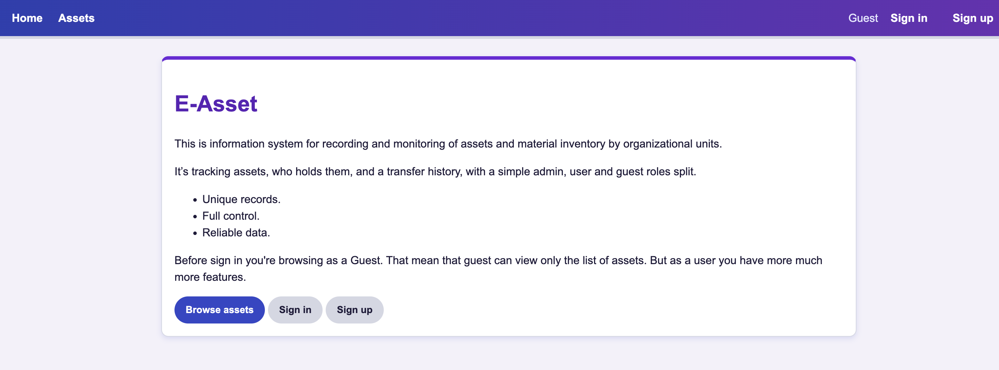
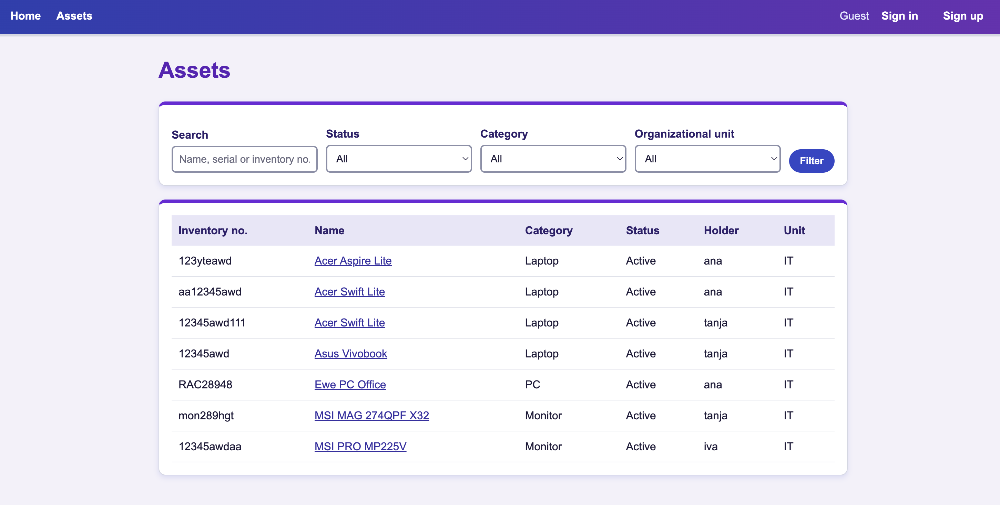
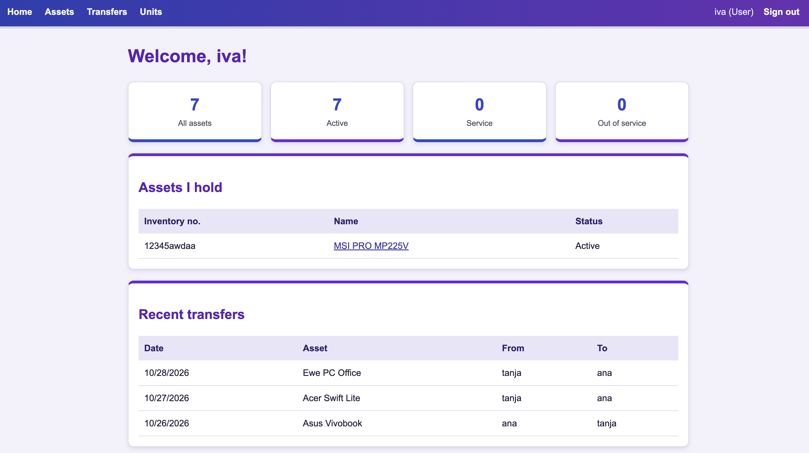
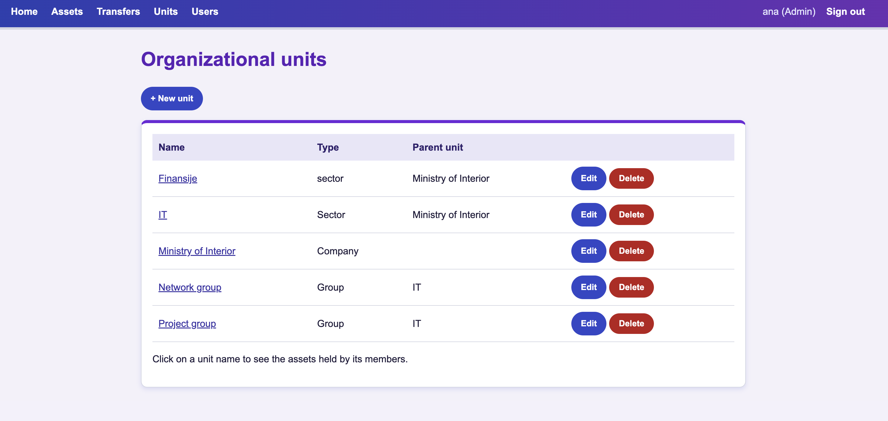
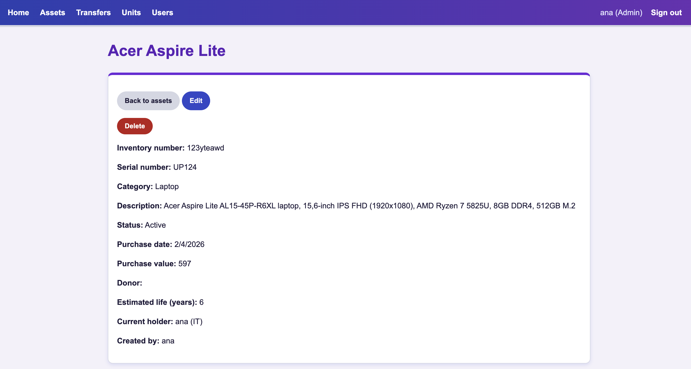

# E-assets
### By: Tatjana Markovic

#### [Portfolio](https:// ) | [GitHub](https://github.com//tatjana2020) | [LinkedIn](https://www.linkedin.com/in/tatjana-markovi%C4%87-b668bb44/)
#### Date: 30/10/2026
***

### ***Description***
E-ASSETS is an aplication for inventory, designed to record and monitor inventory across organizational units. It provides tracking asset, holder assignment, transfer history, and role-based access control (admin, user, and guest). Developed using Node.js, Express, MongoDB, JavaScript, HTML, and CSS and GitHub. This is second Software Engineering project at General Assembly.
***

### ***Technologies Used***
* Node
* Express
* MongoDB
* Javascript
* HTML
* CSS
* GitHub
* Trello
* Vercel

***

### ***Getting Started***

#### 
* Sign In/Sign Up: Create an account or sign in to access the application.
* Role-Based Access: Access features based on your assigned role (Admin, User, or Guest).
* Asset & Inventory Management: Record, organize, and monitor assets and inventory by organizational unit.
* Asset Tracking: View asset details, current status, and assigned holders.
* Asset Transfers: Record and review asset transfers and transfer history.
* Unique Records: Maintain consistent and traceable asset records.
* Reliable Data: Ensure accurate, transparent, and centralized inventory information.
* Sign Out: Securely sign out of your account when finished.
***

### ***Future Updates***

* Manager role: dedicated manager role with unit-level access and permissions.
* Organizational unit hierarchy: implement a hierarchical organizational unit tree for improved structure and navigation.
* Soft delete: enable record archiving and recovery without permanent deletion.
* Asset images: support for multiple images per asset and image uploads.
* Data export: enable excel and PDF exports for reporting and documentation.
* Asset age analytics: introduce asset age analysis and reporting.
* Dark mode: add a dark mode option for improved user experience.
* Automated testing: implement automated tests to improve reliability and maintainability.

### ***Deploy***

[Trello](https://trello.com/b/NTTbIEeP/recording-and-tracking-inventory)

### ***Screenshots***

### ***Credits***
#### Support and Help: 
course - Software Engineering Bootcamp - General Assembly
